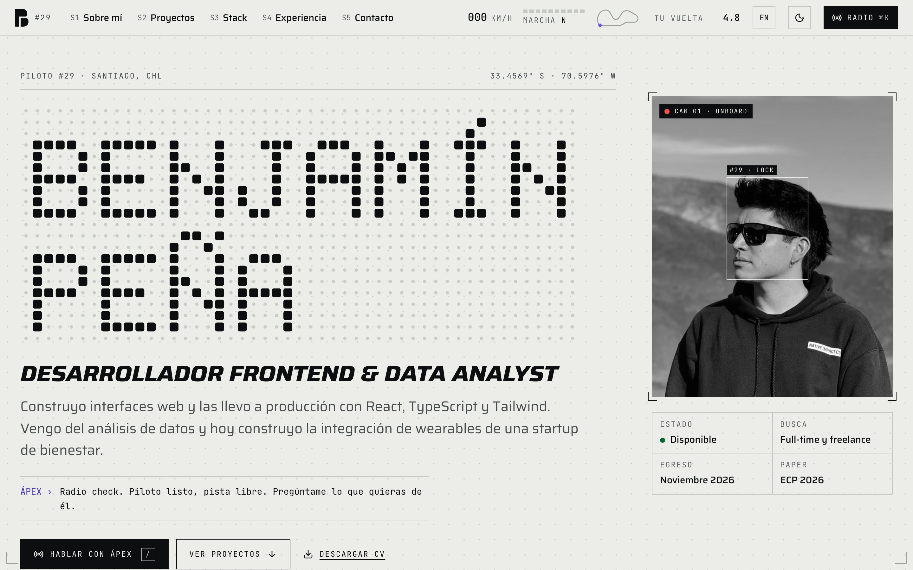
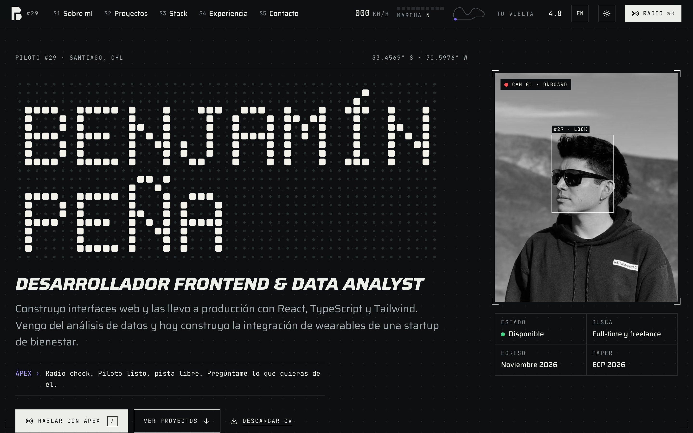
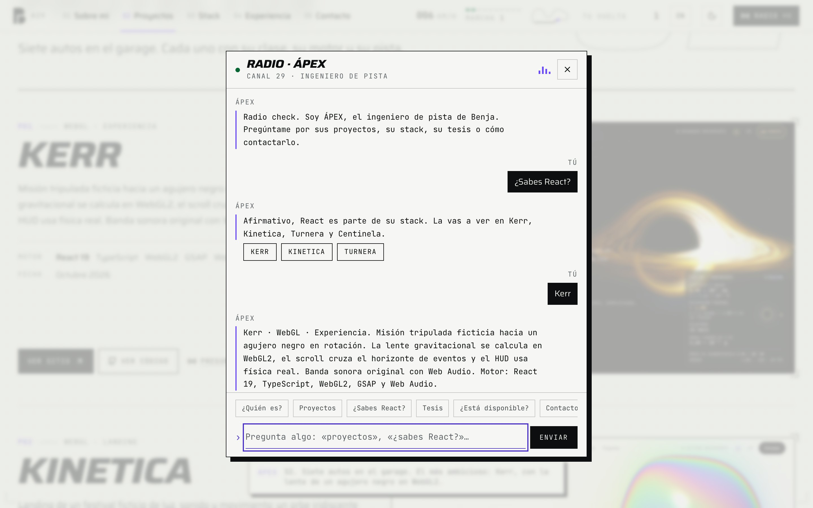
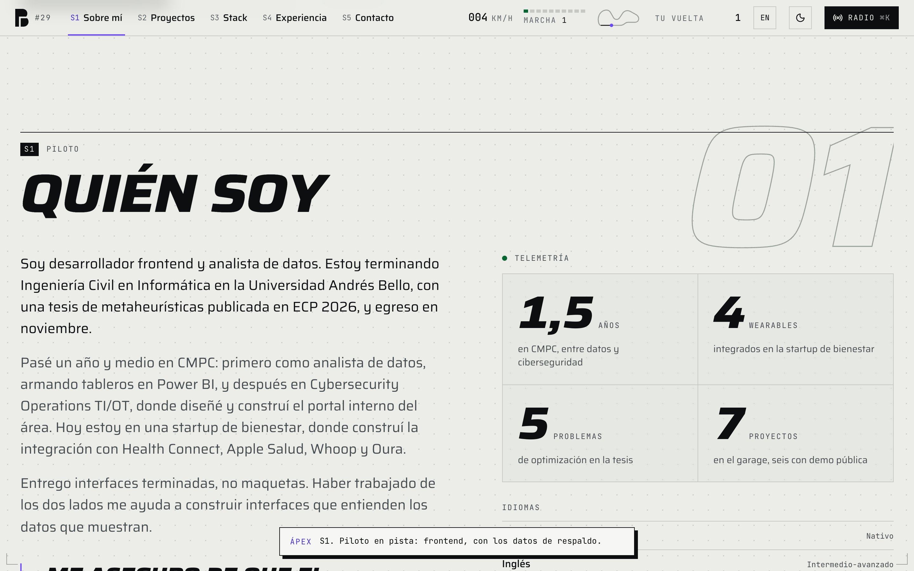
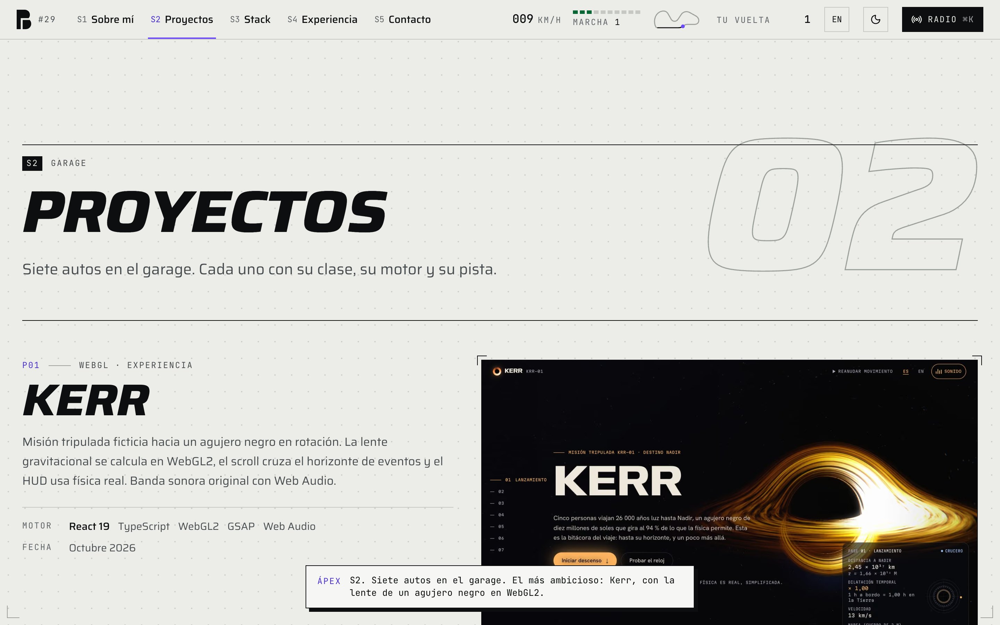
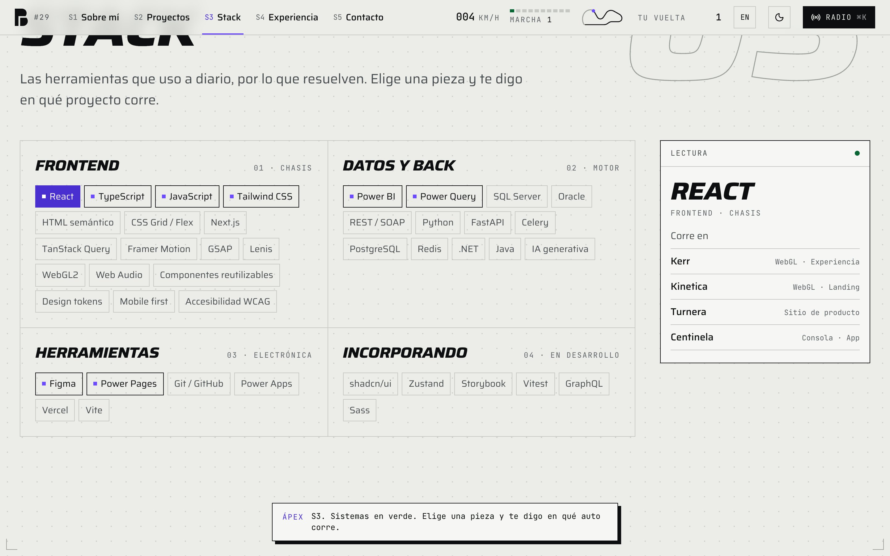
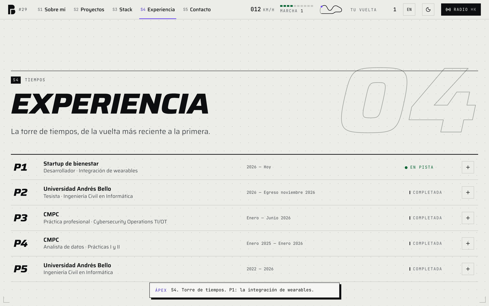
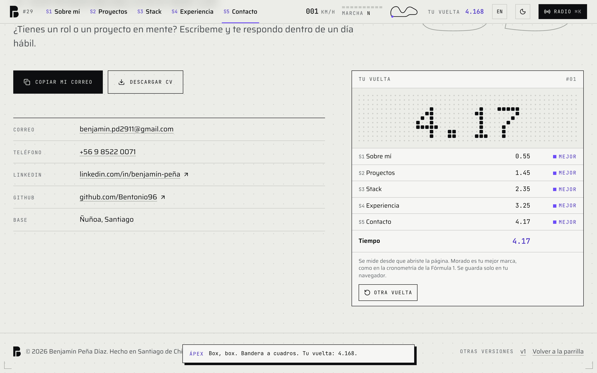
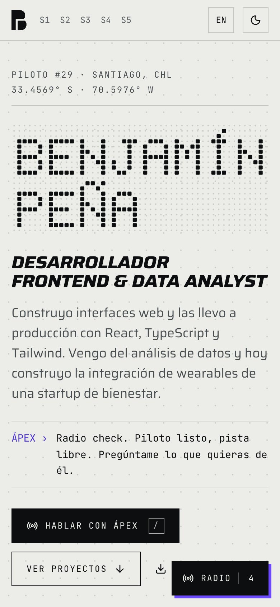
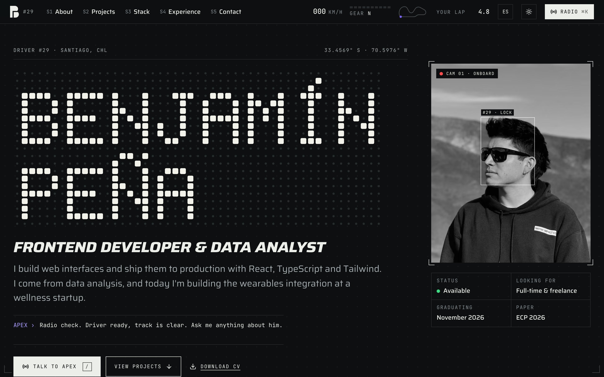

# Benjamín Peña · v3 «Vuelta rápida»

Tercera versión del portafolio de Benjamín Peña Díaz, desarrollador frontend y analista de datos en Santiago de Chile. Vive en la rama `v3` y se publica aparte de la versión principal (`main`, [benjamin-pena.vercel.app](https://benjamin-pena.vercel.app)).



## El concepto

La página es una **vuelta de clasificación**. Benja es el piloto #29 y **ÁPEX**, su asistente, le habla por radio desde el muro de boxes, como el ingeniero de pista en la Fórmula 1 (o como el asistente de cierto ingeniero con armadura). Cada sección es un sector, el scroll es el acelerador y un cronómetro de verdad mide la vuelta de quien visita.

Ningún efecto está de relleno; cada uno dice algo:

| Pieza | Qué es | Qué dice |
|---|---|---|
| **Tablero de LED** | El nombre, dibujado en un canvas con una tipografía de matriz 5 × 7 hecha a mano (con la Í y la Ñ). Se enciende de izquierda a derecha y el puntero calienta los LED hacia el morado. | El tablero de posiciones de un circuito: el piloto en la pantalla grande. |
| **Radio con ÁPEX** | `/` o `⌘K` abre una terminal donde se le pregunta lo que sea: «¿sabes Python?», «Kerr», «¿está disponible?», «modo noche». Responde con un guion, sin API ni costo, y mueve la página por detrás. | Benja trabaja con un agente. Aquí se puede hablar con uno. |
| **Cronómetro de vuelta** | Arranca al abrir la página, toma el tiempo de paso por cada sector y lo muestra en el box, con la cronometría de la F1: morado es la mejor marca. Se guarda en el navegador para comparar la próxima vuelta. | El morado del sector más rápido es el violeta de su CV: el acento tiene significado. |
| **Telemetría del HUD** | Velocidad (km/h) y marcha según la velocidad del scroll, luces de cambio, y el mapa del circuito con el recorrido de la página. | El scroll es el acelerador. |
| **Avisos por sector** | Al cruzar cada sector, ÁPEX dice una línea por radio («S2. Siete autos en el garage…»). | La voz que guía el recorrido. |
| **Cortina del garage** | Cada captura de proyecto está detrás de una cortina de láminas que sube con el scroll. | Los proyectos son autos en su box. |
| **Sistemas** | El stack como piezas del auto (chasis, motor, electrónica, en desarrollo). Al elegir una tecnología, la lectura dice en qué proyectos corre. | El stack se puede verificar contra el trabajo publicado. |
| **Torre de tiempos** | La experiencia como la torre de posiciones de una transmisión, P1 lo más reciente, con `<details>` nativos. | — |
| **Estela** | Celdas de la grilla del papel que siguen al puntero; tinta si va lento, morado si va rápido. | Telemetría del gesto. |
| **Cámara a bordo** | La foto en una mira de cámara con un cuadro de seguimiento sobre la cara. | El piloto, visto desde el auto. |

## Capturas

| Claro | Oscuro (carrera nocturna) |
|---|---|
|  |  |

**La radio con ÁPEX**



**S1 · Piloto**, **S2 · Garage** y **S3 · Sistemas**





**S4 · Tiempos** y **S5 · Box**, con la vuelta terminada




| Teléfono | Inglés |
|---|---|
|  |  |

## Stack

Next.js 15 (App Router, SSG de `/` y `/en`), React 19, TypeScript, Tailwind CSS v4, GSAP + ScrollTrigger, Lenis, canvas 2D, `lucide-react`. Saira (variable, con eje de ancho) y JetBrains Mono por `next/font`.

## Decisiones de diseño

- **Papel de telemetría.** Gris verdoso claro (`#ECEDE9`) con una grilla de puntos fija cada 24 px, tinta casi negra y celdas de 1 px. El modo oscuro es propio, carbón `#0D0F10`, nunca negro puro.
- **Un solo acento, con significado.** El morado marca lo interactivo y lo mejor de la vuelta, como en la cronometría de la F1. El verde («en pista») y el ámbar («sector más lento») solo aparecen con su palabra al lado.
- **La metáfora nunca reemplaza al nombre.** El nav dice «S2 Proyectos», no «Garage»: quien recluta encuentra todo sin traducir.
- **Saira** es una grotesca de transmisión deportiva: los titulares van en itálica expandida (ancho 118), el cuerpo en recta.
- **Escala contenida:** titulares de sección hasta ~5,75 rem y el tablero con un máximo de 880 px de ancho, para que cada sección se lea de una vista.

## Decisiones técnicas

- **ÁPEX es un guion, no un modelo** (`src/lib/apex.ts`). Normaliza el mensaje (minúsculas, sin tildes ni signos) y busca la primera intención que calce, en un orden donde lo específico gana: un proyecto por su nombre, luego CV, contacto, disponibilidad, tesis, experiencia, una tecnología concreta, el stack en general. Todo lo que dice sale de `src/data`, así que nunca inventa. Es un módulo puro con 7 tests (`npm test`).
- **El cronómetro es un store mínimo** para `useSyncExternalStore` (`src/lib/carrera.ts`): el HUD, la radio y el box lo leen sin un proveedor encima. Los tiempos visibles se escriben en el DOM con un intervalo de 100 ms, sin re-renderizar React.
- **Los bucles de animación solo corren cuando hay algo que animar.** El tablero, la estela y el velocímetro se detienen solos cuando todo se enfría: una página quieta no gasta cuadros (pensado para equipos modestos).
- **GSAP y Lenis se importan en diferido** y comparten un solo `requestAnimationFrame`. Nada anima la opacidad del texto.
- **Las fuentes se separan para el LCP.** La Saira recta (el párrafo del hero es el LCP en el teléfono) es la única precargada. La itálica con eje de ancho pesa casi el doble y llega después. Con eso el LCP móvil bajó de 3,6 s a 3,2 s (Lighthouse local).
- **Titulares con ranura recortada solo por abajo** (`clip-path: inset(-1em -1em 0 -1em)`) y no con `overflow: hidden`: así la tilde de «QUIÉN» y la inclinación de la itálica no se cortan.

## Accesibilidad

- `prefers-reduced-motion` apaga Lenis, GSAP, el arranque del tablero, la estela, el tipeo y los pulsos. El cronómetro pasa a actualizarse una vez por segundo.
- **Teclado completo:** skip link, foco visible de 2 px, `<dialog>` nativo para la radio (foco atrapado, `Esc`), `<details>` en la torre de tiempos, `aria-pressed` en el stack. Al saltar de sector, el foco va al titular.
- **Atajos** (`/`, `⌘K`, `1`–`5`, `0`, `N`, `L`, `?`): los de una sola tecla se pueden apagar desde la radio (WCAG 2.1.4) y nunca se disparan mientras se escribe.
- Lo que se tipea o se anima tiene una copia entera para el lector de pantalla: la radio anuncia cada mensaje una vez por una región `log`, y los números vivos del HUD son `aria-hidden` (el tiempo final está en texto en el box).
- El nombre del hero es un `h1` real; el canvas es decorativo. Sin JavaScript se ve el nombre en texto, en la misma caja.

## Rendimiento y calidad (medido el 2026-11-01, build local)

| Prueba | Resultado |
|---|---|
| axe-core (WCAG 2.2 AA + buenas prácticas), ES/EN × claro/oscuro × movimiento/reducido | **0 violaciones** en las 8 variantes |
| Recortes de texto y scroll horizontal en 375, 768 y 1440 px, ES/EN | **0** |
| Lighthouse escritorio | 100 / 100 / 100 / 100 (LCP 0,7 s, CLS 0) |
| Lighthouse móvil | 92 / 100 / 100 / 100 (LCP 3,2 s, TBT 0 ms, CLS 0,001) |
| Tests del guion de ÁPEX | 7 / 7 |

## Cómo correrlo

```bash
npm install
npm run dev                       # http://localhost:3000
npm test                          # guion de ÁPEX
npm run lint && npm run typecheck
npm run build && npm start -- -p 3034
node scripts/revisar.mjs          # axe + recortes (con el build corriendo en :3034)
node scripts/capturar-readme.mjs  # capturas de este README
```

`?` en la página, o «ayuda» en la radio, lista los atajos.

## Estructura

```
src/
  app/[idioma]/          rutas / y /en (SSG), metadata, 404 «fuera de pista»
  components/
    hud/                 Hud (cabina), Radio (ÁPEX), Pista (sectores y atajos)
    secciones/           Parrilla, Piloto, Garage, Sistemas, Tiempos, Box, Vuelta
    TableroLed.tsx       el tablero de LED en canvas
    Estela.tsx           la estela del puntero
    Movimiento.tsx       Lenis + GSAP
  data/                  perfil, proyectos, experiencia, stack (fuente de verdad)
  i18n/diccionario.ts    todo el texto de interfaz, ES/EN
  lib/
    apex.ts              el guion de ÁPEX (puro, con tests)
    carrera.ts           la vuelta: largada, parciales, mejores marcas
    matriz.ts            la tipografía de matriz 5 × 7
tests/apex.test.mjs
scripts/                 revisar, capturas del README y de los proyectos
```

## Deploy

Proyecto de Vercel separado del de `main`, construido desde la rama `v3`.
